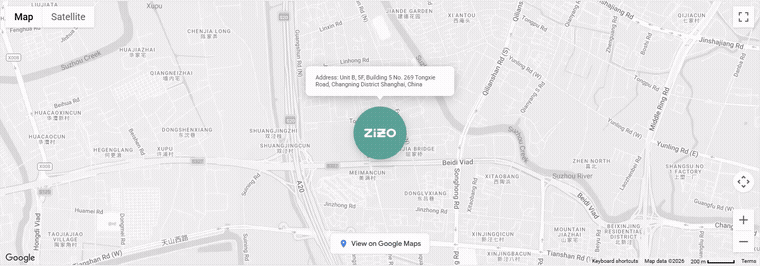

  

# TTT Google Maps for Elementor

**English** | [中文](README.zh-CN.md) | [日本語](README.ja.md)

**A Google Maps widget for Elementor** — one marker or many, fully styled from the panel,
no code required.

---

## Demo

*Click the animation for the full-quality recording → [`assets/demo.mp4`](assets/demo.mp4) (10s).*

---

## What this widget can do

### Placement without coordinates

- **Type an address, get a map** — addresses are converted to coordinates for you, so the
  person editing never has to look up latitude and longitude.
- **Or drop a pin visually** — in the editor, markers can be dragged into position and the
  coordinates are written back automatically.
- **As many markers as you need** — the marker list is user-managed: add, remove and
  reorder entries directly in the panel.
- **Address, pin, or both** — how each location is defined is a per-marker choice.

### Styling that goes as deep as you want

- **Nine built-in map themes** — from clean and light to a dark, low-saturation look,
  selected in one dropdown.
- **Or bring your own** — paste a custom style definition and it is applied verbatim, so
  any look you can build in a Google Maps style editor works here.
- **Every marker is yours** — title, text label and a custom marker image per location.
- **Decide what the visitor can do** — map dragging, scroll-wheel zoom, zoom controls,
  map-type switcher, scale bar, fullscreen, Street View, and a "view on Google Maps" link
  are each an independent switch.

### Built for real editorial work

- **Multi-language maps** — the map's own labels can be set to a specific language, which
  matters on sites that aren't English-first.
- **Advanced options stay out of the way** — deeper settings only appear once the feature
  they belong to is switched on, so the panel stays readable however deep you go.
- **Responsive by default** — appearance and sizing keep their own values per device.
- **Ready for dynamic content** — marker content can be driven by dynamic sources instead
  of being typed by hand.
- **Loads only where used** — styles and scripts arrive only on pages that actually contain
  the widget, leaving the rest of the site untouched.

### Engineering quality

- **No dependencies** — plain JavaScript and CSS. No jQuery, nothing pulled from a CDN.
- **Editor-safe** — re-initialises cleanly on every panel change, without duplicated
  markers or leaked event handlers.
- **Geocoding is cached** — the same address is not looked up twice while you work, which
  keeps editing responsive and avoids unnecessary API calls.

---

## Iteration record

**v1.0.0 → v1.3.1.** The interesting part is a mid-cycle rewrite that cut the JavaScript
from **1,024 lines down to 518** while *adding* controls — the earlier version had grown by
accretion, so it was rebuilt around a clearer separation between map initialisation, marker
handling and control binding.

---

## What this repository is

**Production code, published to show how we build.**

- This is a **snippet**, not an installable plugin. No activation flow, no wp.org release.
- **No installation guide. No support. No portability guarantee.**
- Code assumes an Elementor-based WordPress stack and our own conventions.

---

## Assets

| File | Purpose |
|---|---|
| `assets/demo.gif` | Demo animation (embedded above) |
| `assets/demo.mp4` | Full-quality demo recording — 10s |
| `assets/logo.png` | Brand mark |

---

## Author

**Aloysius Luo** · [TTTWorks](https://tttworks.com)

Production WordPress engineering — performance, security, and custom Elementor widgets
for sites that have to hold up in the real world.

---

## License

Apache License 2.0 — permissive, **commercial use permitted**, trademark rights not granted. See [LICENSE](LICENSE).

---

**[TTTWorks](https://tttworks.com)** — Production WordPress engineering.
